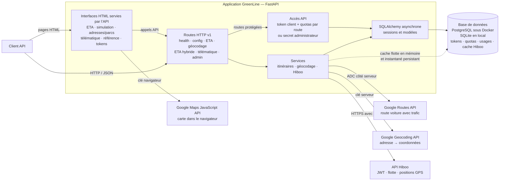
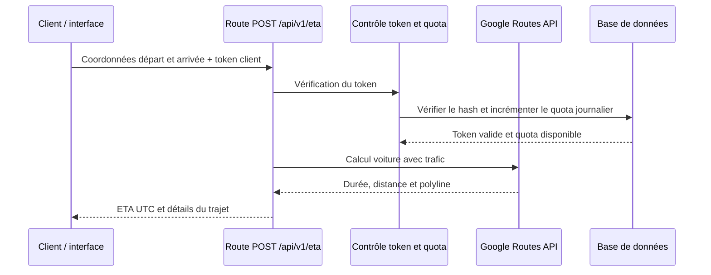
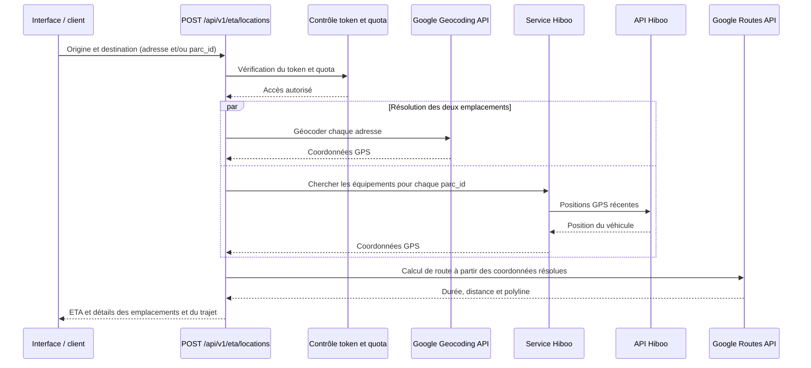
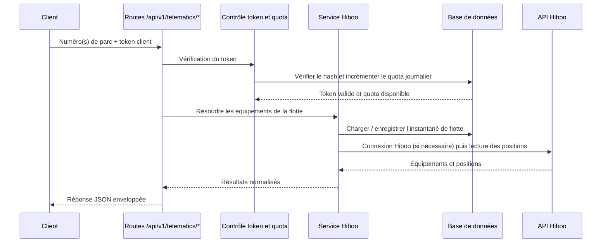

# Architecture GreenLine ETA API

## Vue d’ensemble

## Chemins métier

### Calcul d’ETA

### ETA depuis des adresses et/ou des véhicules

### Télématique

## Composants et déploiement

- **API et interfaces** : FastAPI sert les routes versionnées, la documentation et les pages de test (`/`, `/live`, `/route-tester`, `/telematics`, `/api-reference`, `/token-management`). Les réponses JSON partagent une enveloppe et les erreurs sont normalisées.
- **Routes** : `/api/v1/eta` calcule depuis des coordonnées; `/api/v1/geocode` convertit une adresse; `/api/v1/eta/locations` résout séparément chaque adresse ou parc Hiboo puis calcule l’itinéraire. Les routes télématiques vérifient l’équipement ou renvoient les positions.
- **Accès** : ETA, géocodage, ETA hybride et télématique requièrent un token client et un quota journalier par endpoint. `/api/v1/admin/*` utilise le secret administrateur; santé et configuration publique restent ouvertes.
- **Persistance** : SQLAlchemy asynchrone stocke les tokens (hashés), quotas, usages et instantané Hiboo. SQLite est utilisé en lancement Python local; Docker Compose relie l’API à PostgreSQL.
- **Google** : Routes API calcule les trajets via les identifiants ADC du serveur. Geocoding API utilise une clé serveur dédiée. Maps JavaScript utilise une clé navigateur publique pour afficher la carte.
- **Hiboo** : le service gère le JWT, les reprises sur erreurs temporaires et le cache de flotte (mémoire, durée de vie de 24 h, persistance en base). La flotte se rafraîchit en arrière-plan; les positions sont demandées à Hiboo à chaque appel.
- **Démarrage et conteneurs** : au démarrage, l’application crée le schéma d’accès et restaure le cache Hiboo, puis lance son actualisation si Hiboo est configuré. Docker Compose lance l’API sur le port `8000` et PostgreSQL `16-alpine` sur `5432`; la base utilise un volume et une sonde de santé. Le fichier ADC de l’hôte est monté en lecture seule dans l’API.
